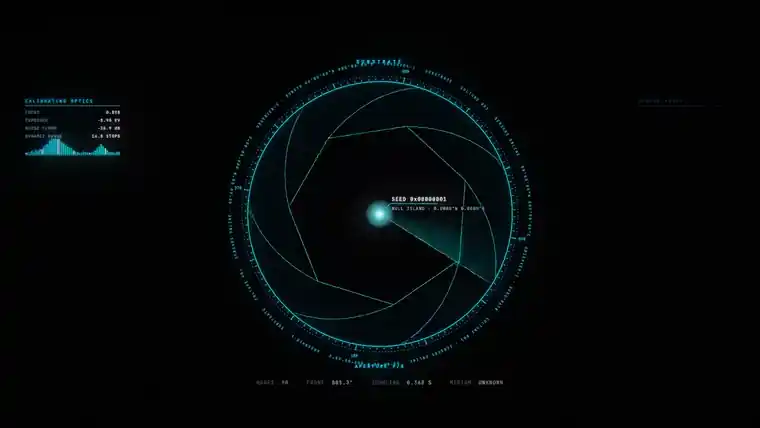
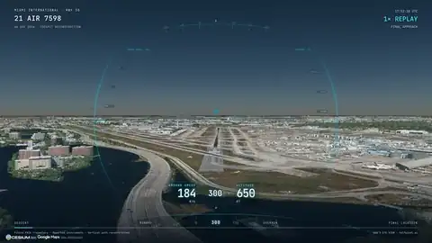
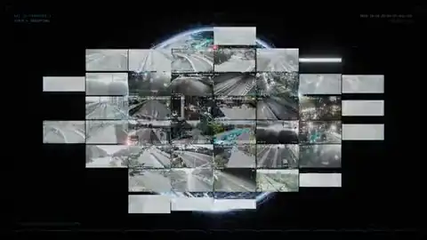
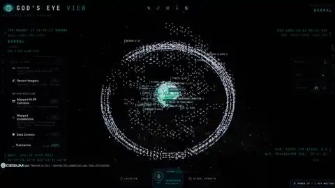
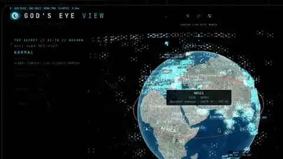
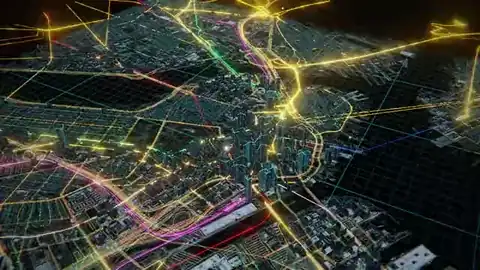
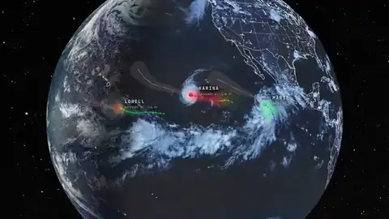

# KEYHOLE


KEYHOLE, a fork of Bilawal Sidhu's God's Eye View, the live 3D globe of public signals, gaining UFO and paranormal correlation layers.

<sub>Repository name: Literally Palantir But Open Source.</sub>

**[Landing page](https://keyhole-41l.pages.dev)** (clips captured from a local run) · **[Run it yourself](SETUP.md)**

> [!IMPORTANT]
> **This is a fork.** Nearly everything here is the work of **[Bilawal Sidhu](https://github.com/bilawalsidhu)** and the God's Eye View community. Bilawal created **[God's Eye View](https://github.com/bilawalsidhu/gods-eye-view)** and released it as open source under the MIT License in August 2026.
>
> - Original project: **https://github.com/bilawalsidhu/gods-eye-view** (official site [godseyeview.ai](https://godseyeview.ai))
> - First imported from upstream commit `880a672` (08/24/2026), and synced to upstream commit `d9d79eb` on 11/21/2026, both with full commit history, so `git log` and `git blame` still credit upstream's authors for their code.
> - If you want God's Eye View itself, the latest features, or to contribute to it, go to the original repository. It is far more active than this fork.
>
> God's Eye View™ is a trademark of Metaversity LLC, used under license by Halfpixel, Inc. This fork uses its own name, KEYHOLE, after the KH reconnaissance satellites and after Keyhole Inc., whose software became Google Earth. Its main purpose is to add correlation data layers from [Strange Signals](https://github.com/Samizdat-Publications/strange-signals). It is not affiliated with, endorsed by, or reviewed by Bilawal Sidhu, Metaversity LLC or Halfpixel, Inc., and it has no connection to Palantir Technologies; the repository name is a tongue-in-cheek nod to the kind of tool this is.



<sub>Capture from the upstream project.</sub>

## What upstream does

God's Eye View is a photorealistic 3D globe in the browser (CesiumJS, on Google Photorealistic 3D Tiles when you have a key and on keyless Esri imagery when you do not) that shows the world's public signals live: aircraft from ADS-B, ships from AIS, satellites propagated from current orbital elements, trains, earthquakes, wildfires, weather radar, traffic, radio stations and thousands of public city cameras projected into the 3D scene. You can ride inside a tracked flight, switch the whole planet into CRT, night vision or FLIR looks, talk to it through a realtime voice agent (OpenAI or Gemini), direct camera stories, and share a view as a link. Every layer keeps its source and freshness visible, and anything modeled rather than live is labelled as such. Upstream's current README is in [README.upstream.md](README.upstream.md).

## What this fork adds

On top of upstream's current code:

- The KEYHOLE name and logo in the window title, header wordmark, loading screen, stories header and install manifest.
- 13 scripted demo tours (landmarks, London cameras, harbour AIS, radio, California CCTV, fire and orbital tours) in [src/scenes/keyholeTours.js](src/scenes/keyholeTours.js), with a test that fails if a tour names a layer upstream has removed.
- An operator setup guide ([SETUP.md](SETUP.md)), a landing page in `site/`, and the notes in [FORK-NOTES.md](FORK-NOTES.md) and [ROADMAP.md](ROADMAP.md).

Earlier fork changes (draggable panels, Gemini HUD summaries, London camera video, voice layer shedding, Cesium ion error text) were dropped in the 11/21/2026 sync in favour of upstream's own, much larger rework of the same areas. FORK-NOTES.md lists what happened to each.

Planned, and the reason the fork exists ([ROADMAP.md](ROADMAP.md)): bring the datasets from my [UAP Correlation Project, Strange Signals](https://github.com/Samizdat-Publications/strange-signals) ([live map](https://strange-signals.stewartgregerson.workers.dev/)) onto this globe as new layers, so anomaly reports sit next to the live air, space and infrastructure picture that explains most of them:

- **UFO / UAP sightings**: about 372,000 geocoded reports (NUFORC through several cleaned datasets, plus the Larry Hatch \*U\* historical catalogue).
- **Paranormal hotspots**: about 8,800 haunted places and 4,200 Bigfoot reports, with population-corrected anomaly scoring so dense cities do not win by default.
- **Confounder overlays**: airports, military and DOE sites, restricted airspace, NASA fireballs, earthquakes and geomagnetic storms, the things a sighting should be checked against first.
- **Correlation views**: the Strange Signals approach of comparing report density against those confounders, shown on the 3D globe instead of a flat map.

None of these correlation layers has landed yet. The core idea is to separate signal from noise: a cluster over a city is population bias, a cluster over empty terrain next to restricted airspace is worth a look, so proximity scoring and comparison against a random baseline matter more than the pins. Upstream's line holds here too: layers model events, places and infrastructure, never named individuals.

## Screenshots

All captures below are from upstream's documentation.

| | |
|---|---|
|  |  |
|  |  |
|  |  |

## How it was made

Upstream: JavaScript with Vue 3 for the interface, [CesiumJS](https://cesium.com/platform/cesiumjs/) and [Vite](https://vite.dev/), with a Node server layer (`server/`) that brokers every secret-bearing provider so API keys stay on your machine, and paid feeds behind cached, budget-governed proxies. [docs/CURRENT-STATE.md](docs/CURRENT-STATE.md) is upstream's runtime reference.

This fork keeps its own code in separate files where it can (the tours are one module plus a two-line hook in upstream's `recipes.js`), so upstream changes can keep being merged in cleanly.

## Run it locally

Requires Node.js 24.14 or newer within 24.x, or 26.x. No key is needed to start: without one the globe runs in 2D on Esri imagery. A Google Maps API key adds the photorealistic 3D city mesh. [SETUP.md](SETUP.md) lists the optional keys and what each one adds.

```
git clone https://github.com/Samizdat-Publications/Literally-Palantir-But-Open-Source.git
cd Literally-Palantir-But-Open-Source
cp .env.example .env
npm install
npm run dev
```

Then open http://localhost:4173. The dev server binds to localhost only; read [SECURITY.md](SECURITY.md) before exposing it to a network, because it brokers your API keys.

To pull in the latest upstream work:

```
git remote add upstream https://github.com/bilawalsidhu/gods-eye-view
git fetch upstream
git merge upstream/main
```

## Credits

| What | Who | Licence |
|---|---|---|
| God's Eye View: all application code, design and documentation from upstream | [Bilawal Sidhu](https://github.com/bilawalsidhu) and contributors, [bilawalsidhu/gods-eye-view](https://github.com/bilawalsidhu/gods-eye-view) | MIT |
| Captures in `docs/media/` | Upstream project | See [docs/media/README.md](docs/media/README.md) |
| 3D models in `public/models/` | Upstream project | See [public/models/README.md](public/models/README.md) |
| Bundled datasets and live feeds | Their providers | Per source, see [DATA_SOURCES.md](DATA_SOURCES.md) and [THIRD_PARTY_NOTICES.md](THIRD_PARTY_NOTICES.md) |
| Planned correlation datasets (NUFORC-derived UFO reports, BFRO, Shadowlands haunted places, OurAirports, NASA CNEOS, USGS) | Their providers, compiled in [Strange Signals](https://github.com/Samizdat-Publications/strange-signals) | Per source, credited there |
| KEYHOLE changes: branding, tours, setup guide, landing page, fork notes | Stewart Gregerson | MIT |

## Licence

The source code is MIT. The [LICENSE](LICENSE) file is upstream's, unchanged, together with its note that the MIT grant covers the code only and not third-party data.

**NOTICE.** Changes made in this fork are Copyright (c) 2026 Stewart Gregerson and are released under the same MIT License. This notice adds to, and does not replace, the original copyright and permission notice in [LICENSE](LICENSE), which must stay with every copy. Some bundled datasets carry non-commercial or share-alike terms; check DATA_SOURCES.md before any commercial use.

Like upstream, this is an exploratory visualisation of public and third-party data that may be delayed, incomplete, modeled or wrong. Do not use it for navigation, emergency response or any other safety-critical purpose.
