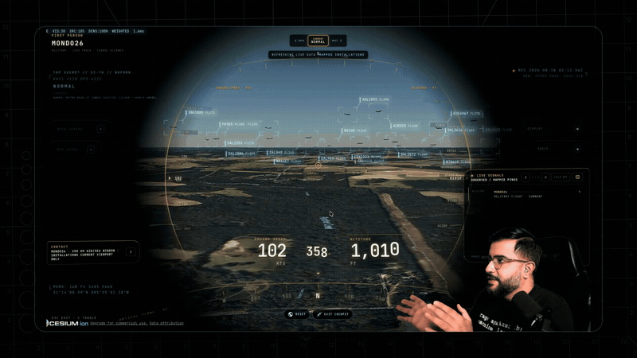
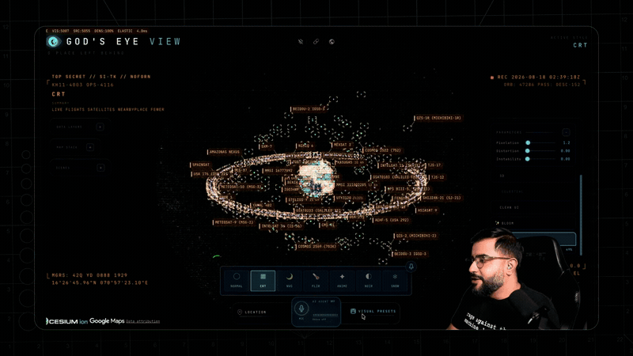
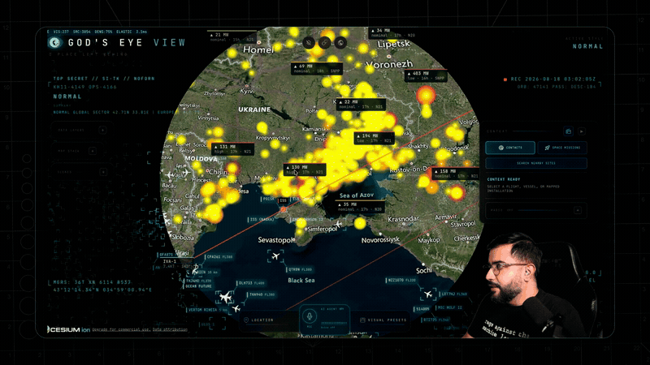
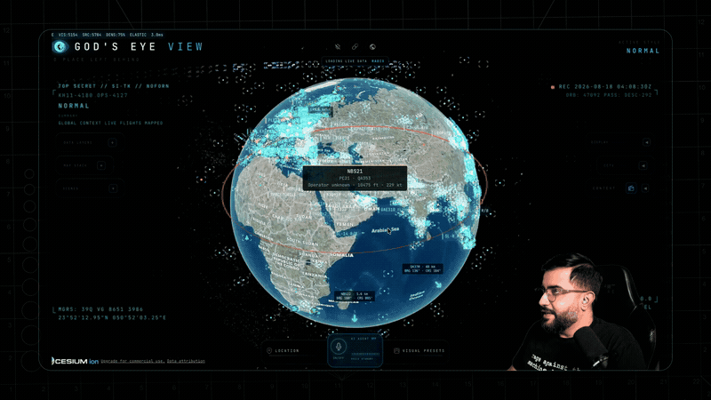

# KEYHOLE


KEYHOLE, a fork of Bilawal Sidhu's God's Eye View, the live 3D globe of public signals, gaining UFO and paranormal correlation layers.

<sub>Repository name: Literally Palantir But Open Source.</sub>

**[Landing page](https://keyhole-41l.pages.dev)** (clips captured from a local run) · **[Run it yourself](SETUP.md)**

> [!IMPORTANT]
> **This is a fork.** Nearly everything here is the work of **[Bilawal Sidhu](https://github.com/bilawalsidhu)**, who created **[God's Eye View](https://github.com/bilawalsidhu/gods-eye-view)** and released it as open source under the MIT License in August 2026.
>
> - Original project: **https://github.com/bilawalsidhu/gods-eye-view** (homepage [maptheworld.ai](https://maptheworld.ai/))
> - Imported from upstream commit `880a672` (24 August 2026) with its full commit history, so `git log` and `git blame` still credit Bilawal for his code.
> - If you want God's Eye View itself, the latest features, or to contribute to it, go to the original repository. It is far more active than this fork.
>
> This fork is called KEYHOLE, after the KH reconnaissance satellites and after Keyhole Inc., whose software became Google Earth. Its main purpose is to add correlation data layers from [Strange Signals](https://github.com/Samizdat-Publications/strange-signals). It is not affiliated with, endorsed by, or reviewed by Bilawal Sidhu, and it has no connection to Palantir Technologies; the repository name is a tongue-in-cheek nod to the kind of tool this is.


<sub>Capture by Bilawal Sidhu, from the upstream project.</sub>

## What upstream does

God's Eye View is a photorealistic 3D globe in the browser (CesiumJS on Google Photorealistic 3D Tiles) that shows the world's public signals live: aircraft from ADS-B, ships from AIS, satellites propagated from current orbital elements, earthquakes, wildfires, traffic, radio stations and public city cameras projected into the 3D scene. You can ride inside a tracked flight, switch the whole planet into CRT, night vision or FLIR looks, draw on the map by voice through a realtime AI agent, and share a view as a link. Every layer keeps its source and freshness visible, and anything modeled rather than live is labelled as such. Upstream's full README, as it was imported, is in [README.upstream.md](README.upstream.md).

## What this fork adds

Already on `main`, on top of upstream:

- The KEYHOLE name, with every runtime string in one file ([src/brand.js](src/brand.js)) that still credits God's Eye View.
- Draggable panels (upstream's drag code was complete but had no handle in the markup).
- Gemini for the HUD scene summary, with OpenAI as the fallback.
- Live London TfL camera video, and 13 scripted demo tours (landmarks, radio, California CCTV and more).
- The voice agent can shed heavy static layers on request.
- Readable Cesium ion 401/403 errors, LF line endings forced so the test suite passes on Windows, and an operator setup guide ([SETUP.md](SETUP.md)).

Planned, and the reason the fork exists ([ROADMAP.md](ROADMAP.md)): bring the datasets from my [UAP Correlation Project, Strange Signals](https://github.com/Samizdat-Publications/strange-signals) ([live map](https://strange-signals.stewartgregerson.workers.dev/)), onto this globe as new layers, so anomaly reports sit next to the live air, space and infrastructure picture that explains most of them:

- **UFO / UAP sightings**: about 372,000 geocoded reports (NUFORC through several cleaned datasets, plus the Larry Hatch \*U\* historical catalogue).
- **Paranormal hotspots**: about 8,800 haunted places and 4,200 Bigfoot reports, with population-corrected anomaly scoring so dense cities do not win by default.
- **Confounder overlays**: airports, military and DOE sites, restricted airspace, NASA fireballs, earthquakes and geomagnetic storms, the things a sighting should be checked against first.
- **Correlation views**: the Strange Signals approach of comparing report density against those confounders, shown on the 3D globe instead of a flat map.

None of these correlation layers has landed yet. The core idea is to separate signal from noise: a cluster over a city is population bias, a cluster over empty terrain next to restricted airspace is worth a look, so proximity scoring and comparison against a random baseline matter more than the pins. Upstream's line holds here too: layers model events, places and infrastructure, never named individuals. Provenance and upstream sync notes: [FORK-NOTES.md](FORK-NOTES.md).

## Screenshots

All captures below are by Bilawal Sidhu, from upstream's documentation.

| | |
|---|---|
|  |  |
|  |  |
|  |  |

## How it was made

Upstream: vanilla JavaScript, [CesiumJS](https://cesium.com/platform/cesiumjs/) and [Vite](https://vite.dev/), Google Photorealistic 3D Tiles for the planet and the OpenAI Realtime API for voice. No framework. Secret-bearing providers are brokered by the dev server so API keys stay on your machine, and paid feeds sit behind cached, budget-governed proxies. [docs/CURRENT-STATE.md](docs/CURRENT-STATE.md) is upstream's runtime reference.

This fork: the correlation layers will follow upstream's one-module-per-layer pattern under `src/data/`, fed by the Strange Signals build scripts, so upstream changes can still be merged in cleanly.

## Run it locally

Requires Node.js 24.14.x or 26.x and a Google Maps API key. [SETUP.md](SETUP.md) lists the four Google Cloud APIs to enable on it, every optional key (OpenAI, Gemini, AISStream, FIRMS, TomTom and more) and what visibly breaks without each one.

```
git clone https://github.com/Samizdat-Publications/Literally-Palantir-But-Open-Source.git
cd Literally-Palantir-But-Open-Source
cp .env.example .env
npm install
npm run dev
```

Put your `GOOGLE_MAPS_API_KEY` in `.env` before `npm run dev`, then open http://localhost:5173. The dev server binds to localhost only; read [SECURITY.md](SECURITY.md) before exposing it to a network, because it brokers your API keys.

To pull in the latest upstream work:

```
git remote add upstream https://github.com/bilawalsidhu/gods-eye-view
git fetch upstream
git merge upstream/main
```

## Credits

| What | Who | Licence |
|---|---|---|
| God's Eye View: all application code, design and documentation imported from upstream | [Bilawal Sidhu](https://github.com/bilawalsidhu), [bilawalsidhu/gods-eye-view](https://github.com/bilawalsidhu/gods-eye-view) | MIT |
| README capture GIFs and PNGs in `docs/media/` | Bilawal Sidhu | Not MIT; redistributed with this repository under his permission, see [docs/media/README.md](docs/media/README.md) |
| 3D aircraft and other models in `public/models/` | Individual authors | Per model, see [public/models/README.md](public/models/README.md) |
| Bundled datasets (TeleGeography submarine cables, OpenStreetMap extracts, NASA FIRMS) and live feeds | Their providers | Per source (CC BY-NC-SA 3.0, ODbL 1.0, CC0 and provider terms), see [DATA_SOURCES.md](DATA_SOURCES.md) |
| Planned correlation datasets (NUFORC-derived UFO reports, BFRO, Shadowlands haunted places, OurAirports, NASA CNEOS, USGS) | Their providers, compiled in [Strange Signals](https://github.com/Samizdat-Publications/strange-signals) | Per source, credited there |
| KEYHOLE changes: branding, panels, tours, provider wiring, setup guide, fork notes | Stewart Gregerson | MIT |

## Licence

The source code is MIT. The [LICENSE](LICENSE) file is upstream's, unchanged: Copyright (c) 2026 Bilawal Sidhu, together with his note that the MIT grant covers the code only and not third-party data, models or media.

**NOTICE.** Changes made in this fork are Copyright (c) 2026 Stewart Gregerson and are released under the same MIT License. This notice adds to, and does not replace, the original copyright and permission notice in [LICENSE](LICENSE), which must stay with every copy. The TeleGeography submarine cable data is CC BY-NC-SA 3.0, so it is non-commercial only; remove it before any commercial use.

Like upstream, this is an exploratory visualisation of public and third-party data that may be delayed, incomplete, modeled or wrong. Do not use it for navigation, emergency response or any other safety-critical purpose.
